# 悬浮炮台PVE伤害草案与整队输出问题

来源：[https://app.notion.com/p/40aa790856e7817faf6fcd2d509f3a2f?pvs=204](https://app.notion.com/p/40aa790856e7817faf6fcd2d509f3a2f?pvs=204)  
Notion 最后编辑：2026-11-09T04:46:22.522Z

## 炮台伤害基准｜30 款逐型号数值（2026-11-09）

本表记录已确认的伤害基准。目标上限限制同时能打到的目标数，各目标独立结算自己命中的伤害段。九曜轰击塔每轮固定九枚弹，按目标数分配直击弹数。萤火双蜂对每个选中的目标发射两枚弹。苍穹链枢塔的锚定和寰星回环塔的回收只结算给主目标。

统一使用主人攻击 40、炮台 1 阶、目标零魔防且无护盾、未聚能、无额外增伤。Q 为单目标整轮预算。C、B、A 的每秒预算分别为主人攻击的 30%、45%、70%。S02 和 S03 为 120%，S01 为 160%，天枢歼星炮为 250%，寰星回环塔为 200%。各段显示减伤和取整前的基础值。整轮扣血按同一目标累计取整，假设适用的各段都命中。按其他角色攻击换算时，各段原始值先乘以“实际攻击 ÷ 40”。

| 品级 | 游戏型号 / 名称 | 间隔（秒） | 射程（米） | 目标上限 | 单目标预算 Q（40 攻击） | 实际各段（40 攻击） | 单目标整轮扣血 | 理论单目标 / 满目标秒伤 |
| --- | --- | --- | --- | --- | --- | --- | --- | --- |
| C | <code>HT_C01_01</code> [追光机炮](https://app.notion.com/p/40aa790856e7817faf6fcd2d509f3a2f#54598cbfc6294bb7b2df9f3396196f3c) | 0.30 | 19.2 | 1 | 3.60 | 单发 3.60 | 4 | 12.0 / 12.0 |
| C | <code>HT_C02</code> [寒霜针塔](https://app.notion.com/p/40aa790856e7817faf6fcd2d509f3a2f#36dc8ba847f34980bc90ffa3dcd0e8fe) | 0.60 | 18.4 | 1 | 7.20 | 针弹 6.12（减速预算 1.08） | 6 | 10.2 / 10.2 |
| C | <code>HT_C03</code> [近卫旋炮](https://app.notion.com/p/40aa790856e7817faf6fcd2d509f3a2f#f29ca64484ba49548144d9f3226f13b5) | 1.80 | 17.2 | 4 | 21.60 | 扇扫 21.60 | 22 | 12.0 / 48.0 |
| C | <code>HT_C04</code> [远望弩塔](https://app.notion.com/p/40aa790856e7817faf6fcd2d509f3a2f#3e594bab5b44441b967504d89881b0f3) | 1.60 | 21.0 | 1 | 19.20 | 蓄力弹 19.20 | 19 | 12.0 / 12.0 |
| C | <code>HT_C05</code> [碎石震炮](https://app.notion.com/p/40aa790856e7817faf6fcd2d509f3a2f#1d96fb981d4542e796f761afa3d2a120) | 2.00 | 18.0 | 2 | 24.00 | 爆炸 24.00 | 24 | 12.0 / 24.0 |
| C | <code>HT_C06</code> [萤火双蜂](https://app.notion.com/p/40aa790856e7817faf6fcd2d509f3a2f#e8f556bf74924a478d13da845736b4f1) | 1.20 | 19.2 | 2 | 14.40 | 每目标双弹 7.20 × 2 | 14 | 12.0 / 24.0 |
| C | <code>HT_C07</code> [鹰眼轨炮](https://app.notion.com/p/40aa790856e7817faf6fcd2d509f3a2f#ee6d9c23c0c949d39f3ce8e5799d0884) | 2.20 | 22.4 | 1 | 26.40 | 蓄力弹 26.40 | 26 | 12.0 / 12.0 |
| C | <code>HT_C08</code> [燧火榴炮](https://app.notion.com/p/40aa790856e7817faf6fcd2d509f3a2f#27c65e9cf8fc4650bb3bcc615980f725) | 2.40 | 18.8 | 3 | 28.80 | 爆炸 28.80 | 29 | 12.0 / 36.0 |
| C | <code>HT_C09</code> [风暴链塔](https://app.notion.com/p/40aa790856e7817faf6fcd2d509f3a2f#f39f211cb65747d38f120fa347a0166e) | 1.75 | 19.6 | 3 | 21.00 | 首击或链击 21.00 | 21 | 12.0 / 36.0 |
| C | <code>HT_C10</code> [烬火喷塔](https://app.notion.com/p/40aa790856e7817faf6fcd2d509f3a2f#2aedca8512f24bd69a87bb676ab35f80) | 0.50 | 18.0 | 1 | 6.00 | 直伤 1.80，灼烧每跳 1.40 × 3 | 6 | 12.0 / 12.0 |
| C | <code>HT_C11</code> [列阵穿炮](https://app.notion.com/p/40aa790856e7817faf6fcd2d509f3a2f#4d8afd90cfa145019d98744abd5b697d) | 2.50 | 20.8 | 3 | 30.00 | 贯穿 30.00 | 30 | 12.0 / 36.0 |
| C | <code>HT_C12</code> [回旋刃盘塔](https://app.notion.com/p/40aa790856e7817faf6fcd2d509f3a2f#46ce1f2f46d54228acef6bbe1b1627a1) | 1.25 | 18.4 | 1 | 15.00 | 去程 9.00，回程 6.00 | 15 | 12.0 / 12.0 |
| B | <code>HT_B01</code> [熔核散射塔](https://app.notion.com/p/40aa790856e7817faf6fcd2d509f3a2f#83e7a64154c94af2aaccb31e08e28ffe) | 2.00 | 23.6 | 3 | 36.00 | 每段 14.40 / 12.60 / 9.00 | 36 | 18.0 / 54.0 |
| B | <code>HT_B02</code> [棱镜分束塔](https://app.notion.com/p/40aa790856e7817faf6fcd2d509f3a2f#04f85913ee664f7ca501f2acbbe4b9c6) | 1.40 | 26.0 | 2 | 25.20 | 分射 25.20 | 25 | 18.0 / 36.0 |
| B | <code>HT_B03</code> [踏雷布点塔](https://app.notion.com/p/40aa790856e7817faf6fcd2d509f3a2f#c4d7aa4200884251997f9a60f01480d7) | 2.40 | 24.4 | 3 | 43.20 | 雷盘触发 43.20 | 43 | 18.0 / 54.0 |
| B | <code>HT_B04</code> [破幕震荡塔](https://app.notion.com/p/40aa790856e7817faf6fcd2d509f3a2f#4adeb80ec5ca402d8c030521f4def31a) | 1.50 | 25.2 | 1 | 27.00 | 直伤 21.60，额外削盾 10.80 | 22 | 14.4 / 14.4 |
| B | <code>HT_B05</code> [凝霜网炮](https://app.notion.com/p/40aa790856e7817faf6fcd2d509f3a2f#fecaf71228144ba2b49050f16c141c61) | 2.20 | 25.2 | 3 | 39.60 | 区域伤害 31.68（控场预算 7.92） | 32 | 14.4 / 43.2 |
| B | <code>HT_B06</code> [寻隙追弹塔](https://app.notion.com/p/40aa790856e7817faf6fcd2d509f3a2f#1736db0d310a4709abf3da1dc21b6070) | 1.20 | 26.4 | 1 | 21.60 | 首发 6.48，追弹 15.12 | 22 | 18.0 / 18.0 |
| B | <code>HT_B07</code> [追猎脉冲塔](https://app.notion.com/p/40aa790856e7817faf6fcd2d509f3a2f#12bdc48a17354f1591712c930d0678a8) | 0.40 | 26.4 | 1 | 7.20 | 脉冲直射 7.20 | 7 | 18.0 / 18.0 |
| B | <code>HT_B08</code> [蓄轨双相炮](https://app.notion.com/p/40aa790856e7817faf6fcd2d509f3a2f#1d2189d3d09b4776b97244096c39d174) | 2.60 | 29.0 | 1 | 46.80 | 各发 11.70 / 35.10 | 47 | 18.0 / 18.0 |
| B | <code>HT_B09</code> [星环扫击塔](https://app.notion.com/p/40aa790856e7817faf6fcd2d509f3a2f#361bc5882b09493d9deab3c3310209a6) | 1.60 | 24.4 | 2 | 28.80 | 扇扫 28.80 | 29 | 18.0 / 36.0 |
| A | <code>HT_A01</code> [陨核簇炮](https://app.notion.com/p/40aa790856e7817faf6fcd2d509f3a2f#c6cfe3fdf0024aa18210306eb4b81dba) | 2.80 | 32.0 | 4 | 78.40 | 主爆 31.36，簇弹每枚 15.68 × 3 | 78 | 28.0 / 112.0 |
| A | <code>HT_A02</code> [巡雷回路塔](https://app.notion.com/p/40aa790856e7817faf6fcd2d509f3a2f#bca888867a654eeabbd9b8043ddefdc3) | 1.80 | 32.4 | 3 | 50.40 | 链击 35.28，回声 15.12 | 50 | 28.0 / 84.0 |
| A | <code>HT_A03</code> [蚀光压制塔](https://app.notion.com/p/40aa790856e7817faf6fcd2d509f3a2f#10f3c737edca4c5cb02d428dcb81fd76) | 0.80 | 31.2 | 3 | 22.40 | 每跳 4.76 × 4（预留 15% 预算） | 19 | 23.8 / 71.4 |
| A | <code>HT_A04</code> [万象星幕塔](https://app.notion.com/p/40aa790856e7817faf6fcd2d509f3a2f#294e59f697d744bca005924d193a02a1) | 2.20 | 32.8 | 4 | 61.60 | 直射或扇面 55.44 | 55 | 25.2 / 100.8 |
| S | <code>HT_S01</code> [九曜轰击塔](https://app.notion.com/p/40aa790856e7817faf6fcd2d509f3a2f#95f484239b9840c9a453cda279e8cc2c) | 0.90 | 39.2 | 4 | 57.60（九发合计） | 九炮口每隔 0.10 秒轮射一枚，每发直击 6.40，溅射 1.60 | 单目标 58；四目标主 19 / 副 13（纯直击） | 64.0 / 64.0（纯直击） |
| S | <code>HT_S02</code> [苍穹链枢塔](https://app.notion.com/p/40aa790856e7817faf6fcd2d509f3a2f#37f95509612b4f9b834da82fdf8dfb85) | 1.75 | 39.6 | 4 | 84.00 | 主目标锚定 10.08，链击 49.28，回响 24.64 | 主目标 84 / 其他 74 | 48.0 / 174.72 |
| S | <code>HT_S03</code> [凝界霜核塔](https://app.notion.com/p/40aa790856e7817faf6fcd2d509f3a2f#aefeaa33c4bc40d2960f43682b016d9e) | 2.25 | 38.0 | 4 | 108.00 | 每跳 43.20 × 2（预留冰封预算 21.60） | 86 | 38.4 / 153.6 |
| SS | <code>HT_SS01</code> [天枢歼星炮](https://app.notion.com/p/40aa790856e7817faf6fcd2d509f3a2f#28ee7cfc210649a8a1090bfc7c508571) | 3.00 | 48.0 | 1 | 300.00 | 蓄能前导 30.00 / 60.00，歼星主炮 210.00 | 300 | 100.0 / 100.0 |
| SS | <code>HT_SS02</code> [寰星回环塔](https://app.notion.com/p/40aa790856e7817faf6fcd2d509f3a2f#73a66a6fa381477498afa7ad2dfe26e5) | 0.60 | 45.6 | 4 | 48.00 | 扇扫每次 14.40 × 2，主目标回收 19.20 | 主目标 48 / 其他 29 | 80.0 / 224.0 |

九曜按目标数分配九枚直击弹。单目标为 9 发，双目标为 5 / 4 发，三目标各 3 发，四目标为 3 / 2 / 2 / 2 发。每次确认直击后，0.75 米内本轮选中的其他目标各受单发 25% 的溅射，整轮最多影响四只。

苍穹链枢塔蓄力 0.25 秒后发出锚定弹，主目标随后承受链击和回响。两段各自沿已命中的目标依次传导，单跳最多 4 米。凝界霜核塔蓄力 0.45 秒后发射一枚霜核，落地后产生两次区域脉冲。

秒伤列统一使用取整前数值。按整数扣血换算，苍穹链枢塔满目标约 174.9/秒，寰星回环塔为 225/秒。链击、贯穿、簇弹、区域攻击仍受距离、遮挡和命中条件影响。

减速与控场使用现有效果。A03 的易伤和 S03 的冰封暂缓实现，对应的 15% 和 20% 只计为预留预算。

浮游守卫 MkⅡ（<code>GuardianDroneMk2</code>）为旧版测试守卫，走独立的原生固定伤害路径。追光机炮旧外观 <code>HT_C01_02</code> 采用 <code>HT_C01_01</code> 的数值。

## 炮台图标

以下为游戏收纳与兑换界面使用的型号预览图，按伤害表顺序排列。 点击伤害表里的炮台名称可跳到对应图标。

### C 级

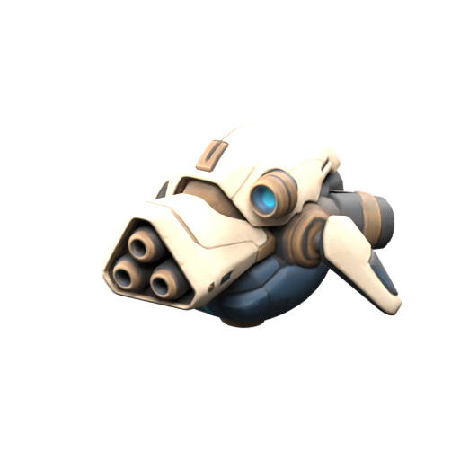

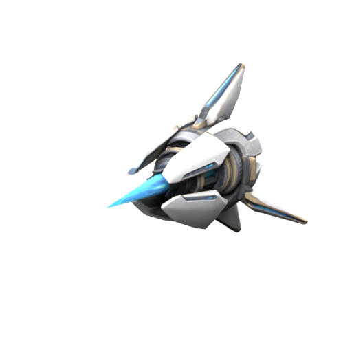

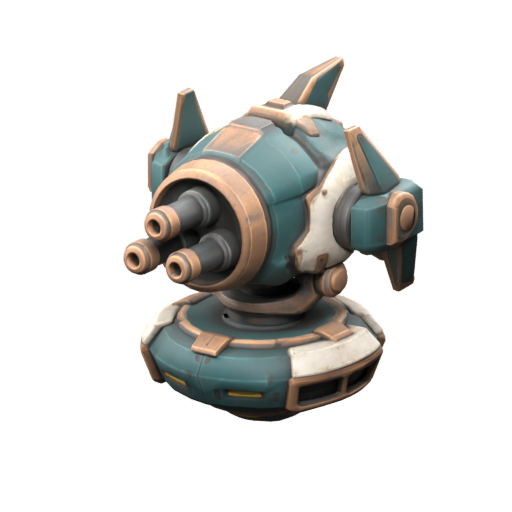

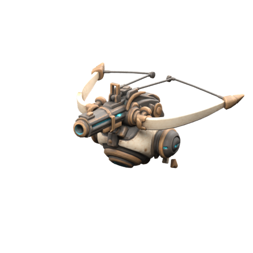

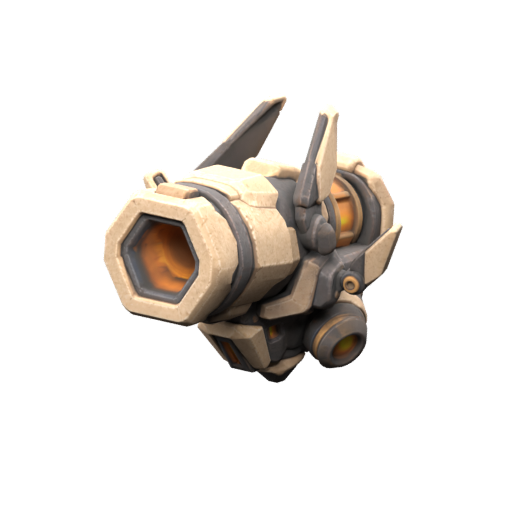

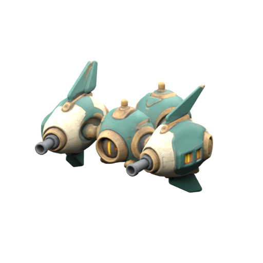

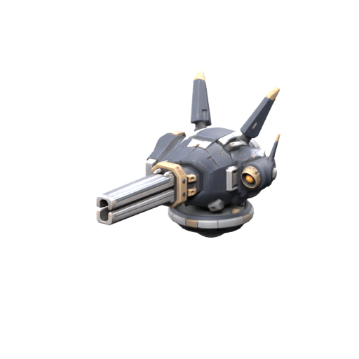

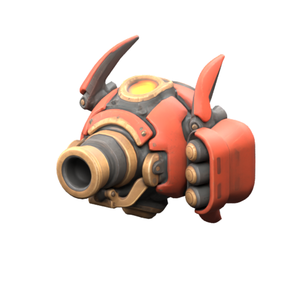

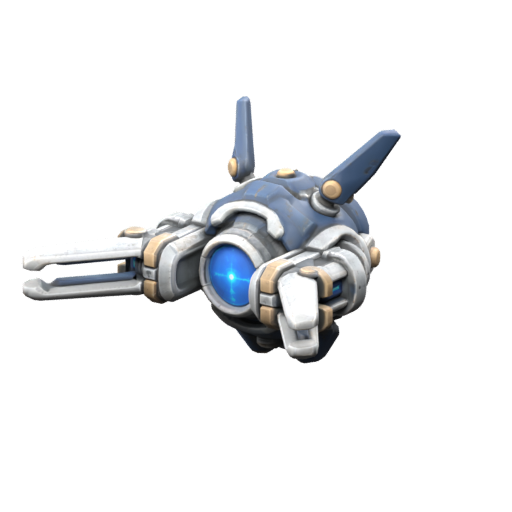

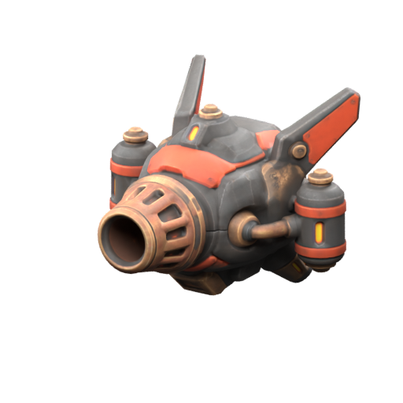

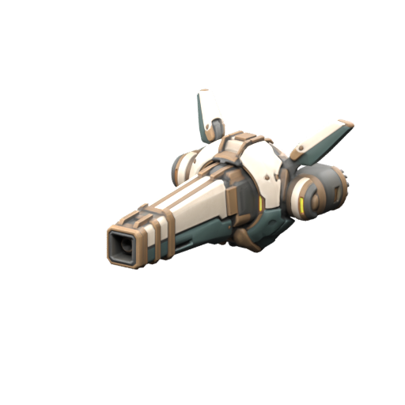

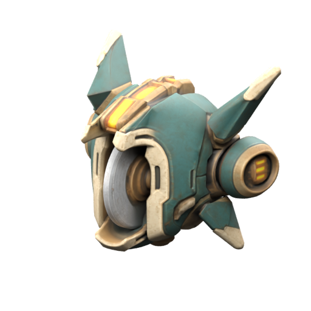

### B 级

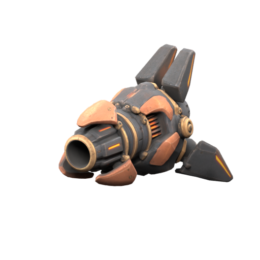

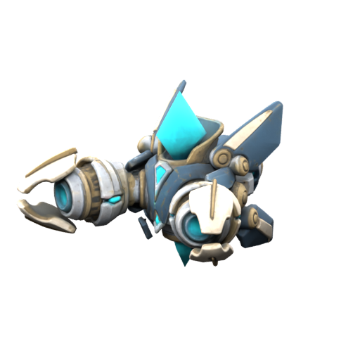

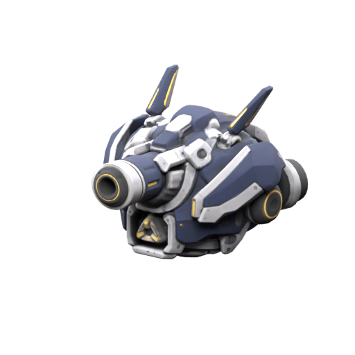

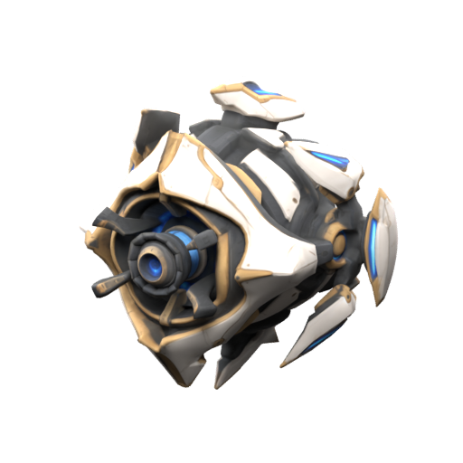

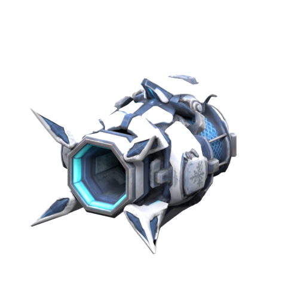

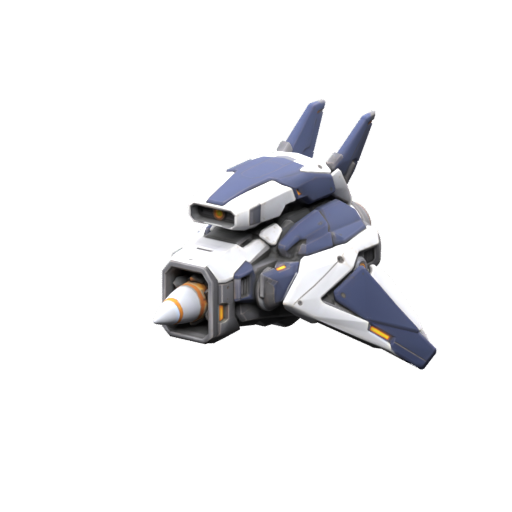

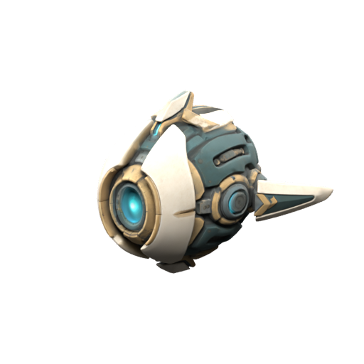

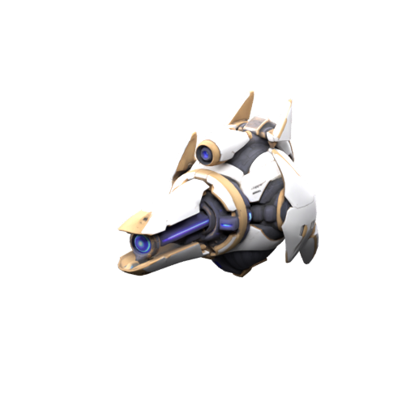

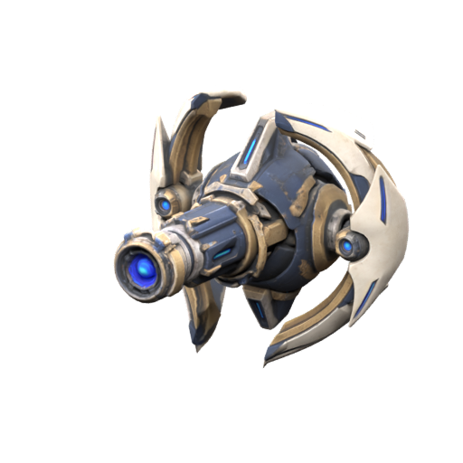

### A 级

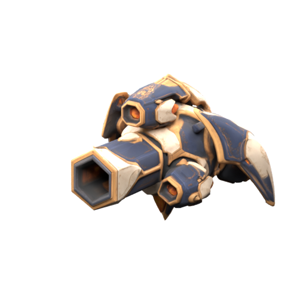

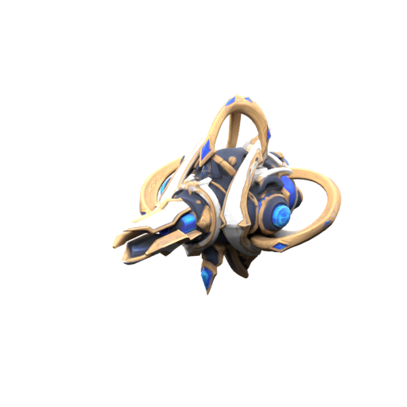

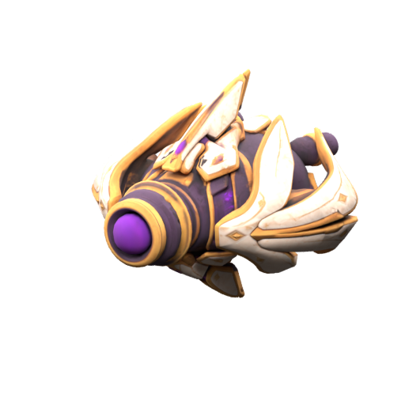

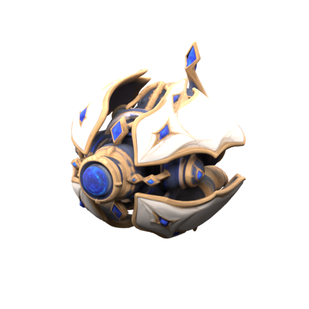

### S 级

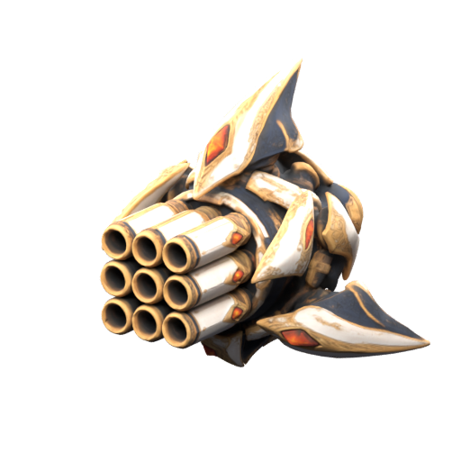

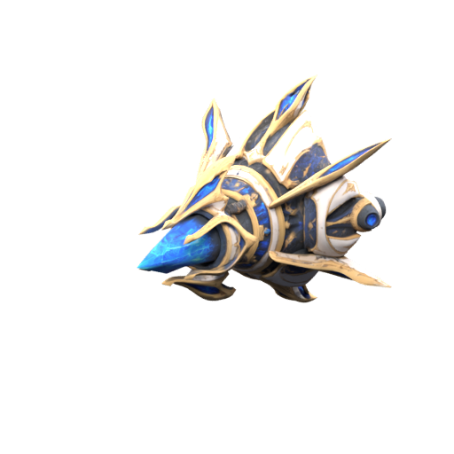

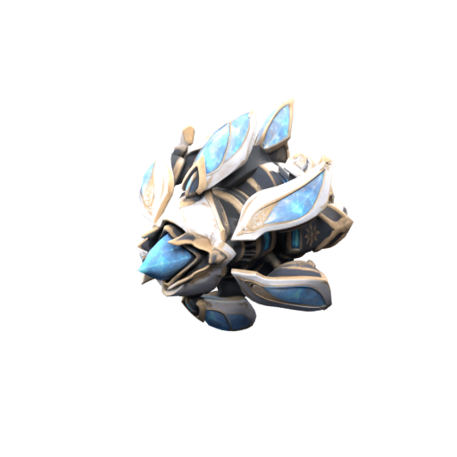

### SS 级

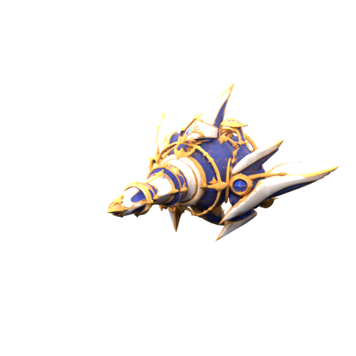

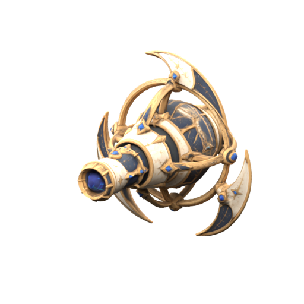

## 历史记录｜S、SS 级伤害调整（2026-11-03）

以下记录 11 月 3 日的旧工程口径。对应型号的当前数值见本页顶部逐炮台表。

A 为角色当前实际攻击力。一阶、未聚能、未计增伤时，每轮伤害预算 = A × 品级每秒预算 × 原始攻击周期；实际按原有攻击份额分配，并受命中、目标数量、法防和护盾影响。

| 界面品级 | 每秒伤害预算 | 适用外观 ID | 对应历史机制 |
| --- | --- | --- | --- |
| S | 0.65A | HT\_S01 | 九曜轰击塔，6 秒，每轮 3.9A |
| S | 0.65A | HT\_S02 | 苍穹链枢塔，5 秒，每轮 3.25A |
| S | 0.65A | HT\_S03 | 凝界霜核塔，5 秒，每轮 3.25A |
| SS | 1.00A | HT\_SS01 | 天枢歼星炮，5 秒，每轮 5A |
| SS | 1.00A | HT\_SS02 | 寰星回环塔，6 秒，每轮 6A |

C、B、A 界面品级的现有预算、攻击周期和分配机制不变。上述是整轮共享预算，群攻不能按每个目标各得完整预算计算；控制等非伤害份额、未命中或目标不足会使实际伤害低于预算。现有聚能替换下一攻击轮，按原规则为该轮预算的 4 倍。

500 级裸装示例：A = 24,770,284；无防御、无增伤、未聚能且全部命中时，C 级鹰眼轨炮单目标每轮约 2,043.5 万，SS 级天枢歼星炮单目标每轮约 12,385.1 万，约 6.06 倍。二者周期不同，这不是每秒输出倍数。

状态：工程 Lua 数值已修改；语法及 31 个正式外观的映射与预算已离线检查，调整后尚未完成游戏内实测。装备、词条、实际命中与目标防御均会改变结果。

同步日期：2026-10-31。本页仅为现有随身炮台公共伤害链草案，尚未实现；不宣称已完成第21F章30款炮台的各型号、C至SS差异化与1至5阶养成，也不因本草案增加独立炮台等级或星级。

2026-10-31，状态：草案，尚未实现。炮台定位为随人物成长的远程单体辅助输出；自动炮提供稳定伤害，第6槽主动提供一次聚能爆发。人物基础、装备、三只战宠、单只神宠和炮台必须纳入同一场战斗预算。

## 核心数值

以<code>A</code>表示服务端在发射瞬间读取的主人当前实际攻击。它已经包含人物基础、装备、词条、修炼、神宠本体与合法临时攻击增幅，不重复叠加这些来源。宠物攻击不并入<code>A</code>。

| 项目 | 草案规则 |
| --- | --- |
| 自动炮 | 每3秒一发，每发基础伤害<code>0.75A</code>，原生单颗弹体、单个目标 |
| 主动名称与槽位 | 聚能射击，使用已有第6槽，来源FloatingTurret |
| 主动效果 | 下一次正常射击改为<code>3A</code>，替换该发<code>0.75A</code>；不另发一颗弹体 |
| 主动冷却 | 30秒，从服务端接受技能时开始；重召、续航刷新和切换不能重置 |
| 聚能保留 | 最长10秒；发出强化弹即消耗，炮台消失则清除，冷却继续 |
| 伤害类型 | 远程法术，使用目标归一化后的法术防御及现有最高70%减伤规则 |
| 暴击与穿透 | 初版不继承主人暴击、暴伤、穿透；炮台不独立暴击 |
| 属性触发 | 不触发主人普攻追加、冰火附着、神宠普攻标记、棱镜转换、陨星或再次召唤 |
| 生命周期 | RPG装备常驻：装备后持续跟随玩家并自动攻击；卸下/切场景/死亡按场景规则隐藏或重建，不设30秒召唤续航 |

自动炮在稳定命中时提供<code>0.25A/秒</code>。理想30秒射击窗口包含10发，其中1发聚能，则总基础伤害为<code>9×0.75A+3A=9.75A</code>，平均<code>0.325A/秒</code>。射程、遮挡、目标死亡、发弹时序、飞行时间和续航空窗都会降低实际输出。

上述25%与32.5%相对于“人物每秒一次1倍攻击”的统一参考，不是对所有武器实际DPS的固定占比，也不是对整支队伍输出的保证比例。后续怪物预算必须使用实际武器、宠物AI和技能冷却的测量结果。

1级裸装<code>A=40</code>时，平射仍为30，聚能为120，可衔接现有低数值体验。无需再新增一条独立炮台等级或星级曲线。

## 命中与结算

只在合法PVE命中上计算<code>基础伤害×(1−min(0.7,有效法防/(400+有效法防)))</code>。有效法防沿用现有目标成长倍率归一化。主人攻击为0时伤害为0；无效目标、无敌与安全保护先行裁决，不能用最低1点伤害穿过保护。正伤害最后按现有规则取整。

<code>A</code>在原生弹体成功发射时取一次快照；聚能也在实际发弹时消耗。弹体飞行途中换装或换神宠不会重算已发弹伤害。聚能激活不重置自动射击间隔，不补立即射击，不提高弹体数量；落空或目标进入无敌仍消耗已发出的聚能弹。

激活需要炮台已装备且当前实例有效、主人可用及存在合法射击目标。条件不足时不进入冷却。激活后目标失效可按原索敌规则重选；聚能待发窗口与冷却不因装备切换、死亡、传送或重连而延长或重置。

## PVE与PVP边界

这套比例仅用于战斗子模式1005内的合法RPG怪物和BOSS。排除本人、队友、其他玩家、玩家战宠、积分赛克隆、装饰物与安全目标；遵守所在岛屿、副本成员、距离和遮挡校验。

1001至1004保留现有30伤害、3秒一发，不引入PVE的主人攻击倍率或聚能主动。其他玩法中的炮台、建筑、核心与召唤浮岛不因本方案自动改值。原商品、费用和库存生命周期沿用现有规则。

## 各区间参考

采用当前区间末级、同岛五件金装强化10星铸10、15条高档面板最优词条；示例未叠称号、修炼、神宠与其他临时攻击增幅。表内均为减伤前理论值，显示作近似。

| 区间末端 | 主人攻击A | 平射每发 | 聚能每发 | 自动平均每秒 | 理想含聚能平均每秒 |
| --- | --- | --- | --- | --- | --- |
| 圣诞岛50级 | 350.38 | 262.78 | 1051.13 | 87.59 | 113.87 |
| 曲水岛100级 | 544.48 | 408.36 | 1633.43 | 136.12 | 176.95 |
| 乐屿岛250级 | 281.4687万 | 211.1015万 | 844.4061万 | 70.3672万 | 91.4773万 |
| 音鸣岛400级 | 2133.9063万 | 1600.4297万 | 6401.7188万 | 533.4766万 | 693.5195万 |
| 雨潮岛550级 | 1.4302亿 | 1.0727亿 | 4.2907亿 | 3575.5859万 | 4648.2617万 |
| 金滩岛700级 | 1434.8125亿 | 1076.1094亿 | 4304.4375亿 | 358.7031亿 | 466.3141亿 |
| 熔岩岛850级 | 172.5438兆 | 129.4078兆 | 517.6313兆 | 43.1359兆 | 56.0767兆 |
| 遗迹岛999级 | 20.1412京 | 15.1059京 | 60.4237京 | 5.0353京 | 6.5459京 |

例如999级上述配置对有效法防180的目标，平射约10.4179京，聚能约41.6716京。神宠等实际增加主人攻击后会自然影响炮台，无需再次乘一层增幅。

## 实现约束

沿用<code>FloatingTurretRuntime</code>的唯一实例与生命周期、<code>FloatingTurretAttack</code>的服务端索敌和原生技能、<code>BP_FloatingTurretBolt</code>的原生弹体。命中问题先排查原生碰撞、阵营、伤害事件与归属链路，不以定时扣血或另一套隐形攻击代替。

伤害归属与数值继承分别处理：击杀及贡献归主人，炮台仍是独立伤害来源。弹体写入<code>0.75A</code>或<code>3A</code>后只能经过一次防御结算，不能再进入主人武器的<code>原始伤害/40×攻击</code>重算，否则会出现攻击被乘两次的错误。补齐归属时也不能因此触发主人普攻与神宠追加。

后续实现触点为<code>FloatingTurretAttack.lua</code>、<code>FloatingTurretRuntime.lua</code>、炮台原生技能及弹体、<code>RestCombat.lua</code>与全局伤害来源路由，以及第6槽授予和移除。多人沿用共享目标缓存、每炮台单个攻击调度及原生复制；不增加逐帧RPC，不向客户端信任攻击值、目标或命中结论。

## 验收条件

- 实际原生弹体命中静止和移动RPG目标，日志记录发弹、命中、来源、减伤和真实掉血。直接ApplyDamage对照仅用于诊断，不代替弹体命中验收。
- 主人攻击40和400时，平射减伤前分别30和300，聚能分别120和1200；无固定30残留、无二次乘主人攻击。
- 第3岛、第6岛及999级取值随当前装备与合法神宠攻击增幅变化，已发弹体保留快照；归一化防御只结算一次。
- 30秒内正常约10发；聚能只替换其中一发，不额外补发。重复点击、重召、续航刷新、换角色不能重复授予或刷新冷却。
- 无敌、同阵营、玩家安全、场景成员、射程和遮挡规则有效；炮台不进入宠物积分赛，也不产生主人普攻递归。
- 1002等PVP冷启动回归仍采用原有30点基础配置；多人观察者只接收必要原生表现，不增加每发独立广播或高频请求。

炮台验收完成后，再把它的持续伤害、30秒聚能爆发窗口与实际可用时长加入八岛怪物预算。800级传说五星战宠回前6岛一击目标继续保留，整套PVE平衡尚待重算。

关联问题见下方当前PVE问题记录，现有实现见当前随身炮台原型和原生攻击编辑记录。

## 当前待解决问题

2026-10-31，用户要求先记录整套输出问题并设计炮台。以下尚未解决；前述装备3.7至4.6倍通过，不代表人物、三宠、单只神宠及炮台的整套PVE平衡已通过。

| 编号 | 问题与证据 | 当前状态与后续 |
| --- | --- | --- |
| PVE01 | 对应岛末级满金装人物的一次1倍非暴击攻击，已能击杀第3至8岛普通怪；统一提高怪物生命攻击3倍没有形成整套输出预算。 | 待按实际持续DPS、爆发、攻击空窗及单人/组队重新校准普通、精英、BOSS。 |
| PVE02 | 审计假设宠物段末40/80/200/320/440/560/680/800级，按可获取高攻击物种组队，第5、6岛三宠面板攻击和约为人物582倍、102倍，至第8岛又为约14.3%。 | 待确定常规培养进度与中期成长关系；这组等级不是已确定关卡门槛，模型不是实机DPS，不据此直接改宠物或竞技快照。 |
| PVE03 | 炮台原生技能仍为30基础伤害、3秒一发。1005运行弹体ownedByPlayer=false，未进入人物武器攻击继承，缺少明确的PVE成长预算。 | 已形成本页炮台伤害草案，尚未实现。 |
| PVE04 | 1005隔离场景中，主人攻击400，炮台已连续发射，4发后目标hpLost=0；目标改属GameMode后再测仍为0。相同目标由玩家直接ApplyDamage对照真实扣300。 | 原生弹体命中/伤害链待定位。instigator=nil只是观察，不能单凭此认定根因；旧1002固定靶通过不能替代1005验收。 |

保留目标：有攻击能力的800级传说五星战宠首次有效命中秒前6岛含全部难度及4人生命BOSS。常规推进与满级宠回刷分别建模；不能用秒杀标记、额外定时扣血绕过自然伤害，也不能用未固定培养进度的输出模型声称BOSS时长已经确定。

证据为<code>tmp/full_party_balance_20261031/current_comparison.json</code>、<code>comparison.csv</code>、<code>native_markers.txt</code>。全套输出模型按人物/每宠每秒1次1倍攻击、朱雀周期均摊作量级检查，不是原生武器或AI实测；炮台未计入可靠有效输出。该轮16:35:43派发，16:48:03清场PASS，停止后独立回读stopped，原属性、目标、炮台及发射钩子均恢复，生产脚本未改。

## 全队输出量级模型与假设

以下只用于检查量级断层，不是实机DPS，也不是已决定的正常养成门槛。人物与每只宠物各按每秒一次1倍攻击，人物计暴击期望，神宠采用朱雀完整24秒周期均摊；宠物段末等级假设40/80/200/320/440/560/680/800，并取该岛之前可获取且已开放的最多三种高攻击宠物（第一岛只有两种）。朱雀本体攻击已并入人物，不重复乘。现有1005炮台命中未扣血，未计入可靠有效DPS；新炮台伤害仍是草案。

| 岛屿段末 | 假设宠物等级 | 人物满金装攻击 | 朱雀本体加攻 | 战宠攻击总和 | 人物神宠与战宠模型DPS | 四队员同模型打四人极限BOSS |
| --- | --- | --- | --- | --- | --- | --- |
| 圣诞岛 | 40 | 350.375 | 2.958 | 80 | 501.115 | 18.521秒 |
| 曲水岛 | 80 | 544.475 | 3.833 | 902 | 1556.643 | 15.583秒 |
| 乐屿岛 | 200 | 281.46871万 | 1.61438万 | 46.2万 | 385.96335万 | 12.388秒 |
| 音鸣岛 | 320 | 2133.90625万 | 11.35313万 | 1.62017亿 | 1.879亿 | 2.183秒 |
| 雨潮岛 | 440 | 1.43023亿 | 73.17188万 | 832.86369亿 | 834.60716亿 | 一轮输出内（模型低于1秒） |
| 金滩岛 | 560 | 1434.8125亿 | 7.16625亿 | 14.63895兆 | 14.81474兆 | 一轮输出内（模型低于1秒） |
| 熔岩岛 | 680 | 172.54375兆 | 8478.75亿 | 1021.66131兆 | 1234.13283兆 | 1.196秒 |
| 遗迹岛 | 800 | 20.14125京 | 978.25兆 | 2.884京 | 27.81112京 | 7.332秒 |

最后一列是四名相同配置玩家各带同配队伍、同时输出的连续均摊预算，不是单人挑战四人生命，也不是实测击杀秒数。射击间隔、AI空窗、弹道、技能段数、转火和控制必须实测后重算。小于一次攻击周期的估算不作为“0.04秒击杀”等游戏承诺。模型证据：tmp/full\_party\_balance\_20261031/current\_comparison.json；命中故障证据与观察不应被写成已定位根因。

## 30款炮台伤害与强化建议（2026-10-31数值版）

状态：<b>拟定方案，尚未实现或实机校准</b>。以10月31日战斗数值汇总为最新基准，取代21F早期独立Q预算和过大品级倍率草案。攻击动作、模型、图标、三券获取和奖池名单不改；本节只拟定伤害与强化。

### 1. 统一口径

- A＝服务器在弹体发射瞬间读取的主人当前实际攻击力，已包含人物基础、装备、词条、修炼、神宠本体及合法临时攻击增益；战宠攻击不并入A。
- 每秒伤害预算由品级决定；单轮完整攻击预算＝品级每秒预算×该型号攻击周期秒数。该轮预算由全部弹丸、光束、爆炸、DOT和多目标共同分配。
- 目标不足、死亡、落空、遮挡、超射程或免疫时，对应份额损失，不转给主目标或幸存目标；分裂弹和链击不得对每个目标重复发完整伤害。
- 原30款攻击机制、攻击周期、目标数、射程和分配比例不变。本节不改模型图标或攻击动作。
- 实际伤害只过一次法防：基础伤害×(1−min(0.7,F/(400+F)))；F为目标归一化有效法防。无敌、安全保护、阵营不合法或主人攻击为0时不造成伤害。
- A在弹体发射时快照；飞行中换装、换神宠不重算已发射弹体。炮台不继承主人暴击、暴伤、穿透，不触发主人普攻、武器词条、神宠普攻被动或自身递归连锁。

### 2. 品级每秒伤害预算

| 品级 | 每秒总预算 | 3秒普通攻击预算 | 第6槽聚能预算 |
| --- | --- | --- | --- |
| C | 0.250A | 0.750A | 3.000A |
| B | 0.275A | 0.825A | 3.300A |
| A | 0.300A | 0.900A | 3.600A |
| S任务基础技能型 | 0.300A | 0.900A | 3.600A |
| S点券/钻石标准技能型 | 0.330A | 0.990A | 3.960A |
| SS | 0.3625A | 1.0875A | 4.350A |

C级3秒周期的0.75A平射和3A聚能与10月31日公共原型完全一致。任务S与A基础伤害预算相同，但任务S固定使用简单基础技能；标准S多出的预算与复杂机制一起计入总预算，不额外叠加技能伤害。

### 3. 历史策划｜30 款型号单轮攻击预算

以下为1阶、减伤前、整轮对全部目标的总预算；多目标比例沿用21F原表，不是每个目标各得全额。

| 品级 | 型号 | 周期 | 单轮总预算 |
| --- | --- | --- | --- |
| C | HT\_C01 追光机炮 | 1秒 | 0.250A |
| C | HT\_C02 寒霜针塔 | 2秒 | 0.500A（80%直伤、20%减速预算） |
| C | HT\_C03 近卫旋炮 | 1.5秒 | 0.375A |
| C | HT\_C04 远望弩塔 | 2.5秒 | 0.625A |
| C | HT\_C05 碎石震炮 | 2秒 | 0.500A |
| C | HT\_C06 萤火双蜂 | 2秒 | 0.500A |
| B | HT\_B01 鹰眼轨炮 | 3秒 | 0.825A |
| B | HT\_B02 燧火榴炮 | 2.5秒 | 0.6875A |
| B | HT\_B03 风暴链塔 | 2秒 | 0.550A |
| B | HT\_B04 烬火喷塔 | 3秒 | 0.825A（直伤30%、DOT合计70%） |
| B | HT\_B05 列阵穿炮 | 3秒 | 0.825A |
| B | HT\_B06 回旋刃盘塔 | 2.4秒 | 0.660A（去程60%、回程40%） |
| A | HT\_A01 熔核散射塔 | 4秒 | 1.200A（点射40/35/25%） |
| A | HT\_A02 棱镜分束塔 | 2.4秒 | 0.720A（主束60%、副束40%） |
| A | HT\_A03 踏雷布点塔 | 3秒 | 0.900A（最多三目标共享） |
| A | HT\_A04 破幕震荡塔 | 3秒 | 0.900A（直伤70%、破盾预算30%） |
| A | HT\_A05 凝霜网炮 | 4秒 | 1.200A（区域伤害75%、减速预算25%） |
| A | HT\_A06 寻隙追弹塔 | 3秒 | 0.900A（标定30%、追弹70%） |
| S任务 | HT\_S01 追猎脉冲塔 | 2秒 | 0.600A |
| S标准 | HT\_S02 蓄轨双相炮 | 4秒 | 1.320A（校准束25%、主束75%） |
| S标准 | HT\_S03 陨核簇炮 | 4秒 | 1.320A（主弹40%、三子弹各20%） |
| S标准 | HT\_S04 巡雷回路塔 | 3.6秒 | 1.188A（目标50/30/20%，首段70%、尾段30%） |
| S标准 | HT\_S05 蚀光压制塔 | 4秒 | 1.320A（区域伤害75%、减速预算25%） |
| S任务 | HT\_S06 星环扫击塔 | 3秒 | 0.900A（目标份额60/40%） |
| SS | HT\_SS01 天枢歼星炮 | 5秒 | 1.8125A（标定10%、预脉冲20%、主炮70%） |
| SS | HT\_SS02 万象星幕塔 | 6秒 | 2.175A（伤害90%、模式适配10%） |
| SS | HT\_SS03 九曜轰击塔 | 6秒 | 2.175A（九弹合计100%） |
| SS | HT\_SS04 苍穹链枢塔 | 5秒 | 1.8125A（锚定10%、链击60%、尾击30%） |
| SS | HT\_SS05 凝界霜核塔 | 5秒 | 1.8125A（区域/爆裂75%、减速预算25%） |
| SS | HT\_SS06 寰星回环塔 | 6秒 | 2.175A（外扫30%、回收30%、收束40%） |

控制、破盾和模式适配所占预算不能在目标免疫时转为伤害。DOT不叠层，旧尾跳与新一轮首段按原时序结算，不补跳。

### 4. 第6槽聚能射击

- 保留10月31日定义：固定第6槽FloatingTurret；服务端接受后开始30秒冷却，聚能最长保留10秒。
- 聚能替换下一次完整自动攻击周期，不额外发弹、不重置普通射击间隔。
- 聚能伤害统一为“该型号当前强化阶的单轮普通攻击预算×4”，而不是所有型号固定使用3秒预算。这样保留公共原型中3秒、0.75A炮台聚能3A的基准，同时避免1秒快炮与6秒慢炮得到不合理的相同聚能数值。例：C01单轮0.25A，聚能1A；C02单轮0.50A，聚能2A；B01单轮0.825A，聚能3.3A；A01单轮1.2A，聚能4.8A；S02单轮1.32A，聚能5.28A；SS02单轮2.175A，聚能8.7A。聚能仍只替换下一轮，不额外增加攻击次数；多目标按该型号原有分配比例共享聚能总预算。
- 聚能沿用该型号弹道、目标数和伤害分配；全体目标合计不得超过聚能总预算。落空或目标无敌仍消耗已发出的聚能弹；条件不合法、没有炮台或没有合法目标时不进入冷却。
- 重召、续航刷新、换目标、换装和重连不重置冷却；炮台消失清除未发出的聚能状态，冷却继续。

### 5. 五阶强化

使用型号专属碎片，不新增炮台经验等级、星级、强化石或第四种抽奖券。强化只提高该型号全部伤害预算，不改变攻击方式、频率、目标数、射程、控制时长或冷却。

| 强化阶 | 预算倍率 | C | B | A | 任务S | 标准S | SS |
| --- | --- | --- | --- | --- | --- | --- | --- |
| 1阶 | 1.00 | 0.250A | 0.275A | 0.300A | 0.300A | 0.330A | 0.3625A |
| 2阶 | 1.10 | 0.275A | 0.3025A | 0.330A | 0.330A | 0.363A | 0.39875A |
| 3阶 | 1.20 | 0.300A | 0.330A | 0.360A | 0.360A | 0.396A | 0.435A |
| 4阶 | 1.30 | 0.325A | 0.3575A | 0.390A | 0.390A | 0.429A | 0.47125A |
| 5阶 | 1.40 | 0.350A | 0.385A | 0.420A | 0.420A | 0.462A | 0.5075A |

#### 强化消耗

沿用21F已有型号碎片成本；100%成功，必须使用同型号碎片。首个本体兑换后为1阶。

| 品级 | 兑换本体 | 1→2 | 2→3 | 3→4 | 4→5 | 至5阶总片数 |
| --- | --- | --- | --- | --- | --- | --- |
| C | 30 | 12 | 18 | 30 | 45 | 135 |
| B | 40 | 16 | 24 | 40 | 60 | 180 |
| A | 60 | 24 | 36 | 60 | 90 | 270 |
| S（两技能档） | 80 | 32 | 48 | 80 | 120 | 360 |
| SS | 100 | 40 | 60 | 100 | 150 | 450 |

- HT\_C01碎片只能强化HT\_C01；不同型号不能混用，任务S碎片不能强化标准S。
- 每个型号永久本体最多1台；不因收藏其它型号增加并发挂载。
- 1/3/5阶可更换外壳、散热片、能量纹路表现；外观变化不新增弹体或攻击事件。
- 5阶封顶，不开放+6、无限星级或重复融合。满阶后的剩余碎片保留，不自动兑换货币。
- 若强化收益被玩家1极上限完全抵消，预览显示有效提升为0，并禁止扣片。

### 6. 八岛伤害参照

使用10月31日战斗汇总中各岛末级、五件金装强化10/星铸10、15条高档面板最优词条的主人攻击A；防御采用同岛BOSS表中的归一化有效防御F。数值为约数，仅供比较，不代表每个玩家都拥有该配置。

| 岛屿末级 | 人物A | 有效防御F | C普通3秒攻击 | C聚能 | SS普通3秒攻击 | SS聚能 |
| --- | --- | --- | --- | --- | --- | --- |
| 圣诞50 | 350.38 | 40 | 239 | 956 | 346 | 1,386 |
| 曲水100 | 544.48 | 60 | 355 | 1,420 | 515 | 2,060 |
| 乐屿250 | 281.4687万 | 80 | 175.92万 | 703.67万 | 255.08万 | 1020.32万 |
| 音鸣400 | 2133.9063万 | 100 | 1280.34万 | 5121.38万 | 1856.50万 | 7425.99万 |
| 雨潮550 | 1.4302亿 | 120 | 8251.15万 | 3.30046亿 | 1.19642亿 | 4.78567亿 |
| 金滩700 | 1434.8125亿 | 140 | 797.12亿 | 3188.47亿 | 1155.82亿 | 4623.28亿 |
| 熔岩850 | 172.5438兆 | 160 | 92.43兆 | 369.74兆 | 134.03兆 | 536.12兆 |
| 遗迹999 | 20.14125京 | 180 | 1.0418京 | 4.1671京 | 1.5106京 | 6.0424京 |

表中按3秒标准周期展示；其它周期按第3节的完整攻击预算，多目标再按原比例拆分。以上未乘强化倍率，5阶乘1.4。战宠攻击不进入A，人物和神宠攻击只计一次。

### 7. 整队预算与模式边界

10月31日整队输出模型已发现中后期战宠可能成为主要输出来源，炮台不能孤立调高。当前整队模型仍为量级估算，尚未完成原生AI持续输出实测。

- 炮台独立记录伤害来源，击杀与贡献归主人；不触发人物普攻、神宠普攻被动或武器成长的虚假命中。
- 随身炮台只有1个挂载位；30款收藏不能叠加。
- 1001—1004继续保持既有PVP炮台30基础伤害、3秒一发，不继承PVE的A倍率、品级倍率或聚能。
- 所有炮台伤害、DOT、控制、聚能与强化收益进入玩家1极综合预算；不能面板封顶而真实伤害继续溢出。
- 通天塔首版仍不开放悬浮炮台；未来开放时，悬浮炮台与战争浮岛最多4座实体塔必须进入同一整队预算。

### 8. 验收条件与待测项目

1. A=40、400时，C级3秒周期平射减伤前分别为30、300；聚能分别为120、1200；没有固定30残留或二次乘A。
2. 第3、第6岛和999级使用当前装备与合法神宠攻击增益，验证A快照与法防只结算一次。
3. 30秒聚能只替换一轮普通攻击，不额外补发；重复点击、重召、续航刷新、换装和重连不重置冷却。
4. 30款逐一验证多目标预算守恒、目标失效份额损失、DOT尾跳、控制免疫和遮挡。
5. 验证1—5阶碎片扣除、5阶封顶、1极溢出不误扣、不同型号碎片不串用。
6. 原生弹体命中、归属、日志和真实掉血通过后，才将草案标记为实现；不得用定时扣血或隐形攻击替代原生弹体。

### 9. 当前尚未解决

- 10月31日公共炮台原型的原生弹体在1005中出现“连续发射但目标HP未减少”；直接ApplyDamage对照能扣血，原生碰撞/阵营/伤害归属链仍待定位。
- 人物、三只战宠、单只神宠与炮台的整队持续DPS还没有实机完整校准；本方案是炮台自身预算提案，不代表全队平衡通过。
- 第7、8岛大数使用原生float，显示和伤害会有相对误差，需按现有大数同步规则验收。

## 悬浮炮台统一AI循环入口（2026-10-31）

30款炮台共用FOLLOW\_IDLE、SCAN、ACQUIRE、TRACK、WINDUP、FIRE、RECOVERY、RETARGET状态机；统一玩家指定目标优先、威胁目标次之、精英/BOSS优先于普通怪的索敌规则。30秒召唤续航、30秒聚能冷却和各型号1–6秒攻击周期分别计时。完整跟随、转火、聚能插入、生命周期、动画同步、服务器调度与验收条件见[21F 悬浮炮台｜30款五品级与三券混合碎片池](409a790856e781cc93f7e2e2edbc8577.md)中的“悬浮炮台统一战斗循环与召唤生命周期”章节。此为AI设计提案，尚未接入原生AI或完成实机验证。
